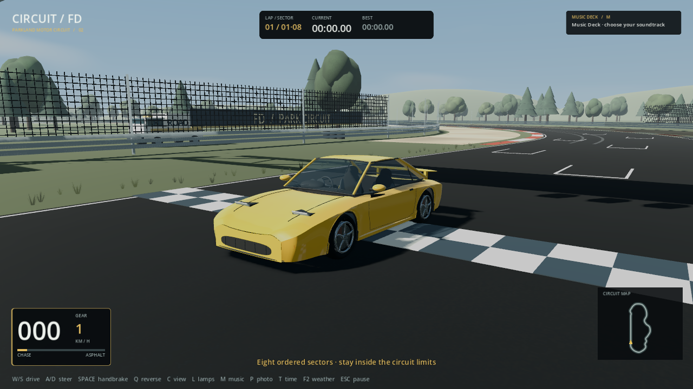
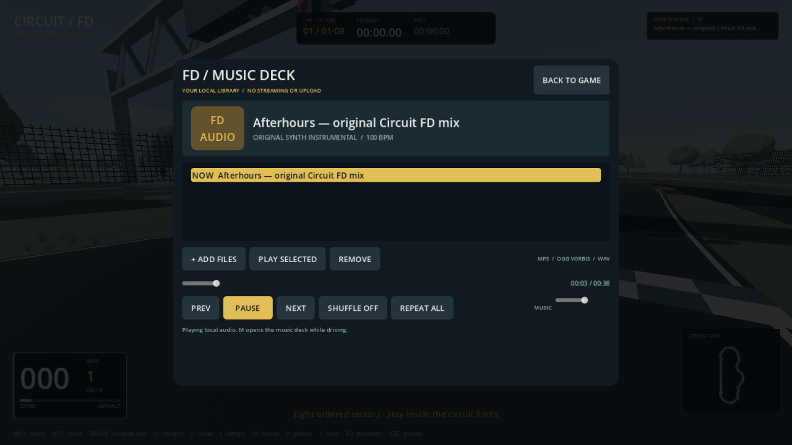

# Circuit FD / Park Sessions — نسخهٔ ۰٫۲

بازی مستقل رانندگی با خودروی زرد تقریبی الهام‌گرفته از RX-7 FD و پیست پارکی ۱٫۴۷ کیلومتری. نسخهٔ جدید شامل Music Deck، Photo Studio، سه نور و سطح خشک/خیس است.

## دریافت مستقیم

- [بازی Windows x64 — حدود ۴۳ مگابایت](https://github.com/Hello123gdjd/panacea1/raw/refs/heads/main/downloads/CircuitFD-Windows-x64.zip?version=0.2)
- [سورس کامل، تست‌ها و ابزار ساخت — حدود ۸٫۳ مگابایت](https://github.com/Hello123gdjd/panacea1/raw/refs/heads/main/downloads/CircuitFD-Source.zip?version=0.2)
- [SHA-256 بسته‌ها](downloads/SHA256.json)

ZIP ویندوز را کامل استخراج کنید و `CircuitFD/CircuitFD.exe` را اجرا کنید. راهنمای فارسی، تصاویر واقعی، گزارش‌ها و مجوزها همراه بسته‌اند.

## امکانات جدید

- بدنه و نرمال‌های نرم‌تر، سقف و ستون عقب، چراغ‌های هم‌سطح‌تر، رینگ و ترمز دقیق‌تر.
- نور Day/Golden hour/Dusk، آسمان ابری، بازتاب محلی پیت و SSAO محدود در High.
- سطح خیس با ظاهر و چسبندگی متفاوت، پیت و محیط با جزئیات بیشتر.
- **M:** پلیر واقعی MP3/OGG Vorbis/WAV، فهرست، seek، pause، shuffle، repeat و ولوم مستقل. قطعهٔ اصلی ۳۸٫۴ ثانیه‌ای هم همراه است.
- **P:** حالت عکاسی؛ drag برای چرخش، wheel برای زوم، **F12** ذخیرهٔ PNG واقعی بدون HUD.
- **T:** نور، **F2:** خشک/خیس. کنترل رانندگی: W/S/A/D، Q جلو/عقب، C دوربین، L چراغ، R ریست، Esc توقف.

## تصاویر واقعی

تصاویر از خود بازی، High، رندر نرم‌افزاری Linux، ۱۲۸۰×۷۲۰ هستند؛ تصویر تبلیغاتی تولیدشده نیستند.

[کابین](images/v02-cockpit.png) · [گرگ‌ومیش/خیس](images/v02-dusk-wet.png) · [نمای نسخهٔ قبلی۰٫۱](images/v01-front.png)

## وضعیت تست و محدودیت

۲۳۸ بررسی منطق/تعامل موفق و دو دور معتبر خشک/خیس ثبت شد. ذخیرهٔ F12 با رندر واقعی و محتوای PCK جاسازی‌شده در EXE بررسی شد. EXE واقعی Windows x64 ساخته شده اما اجرای بومی ویندوز، کیفیت شنیداری و بنچمارک GPU کاربر انجام نشده‌اند. رندر نرم‌افزاری این محیط کند است؛ ۶۰ FPS تضمین نمی‌شود.

مدل و محیط سبک‌پردازی‌شده و تقریبی‌اند، نه CAD کارخانه‌ای یا محصول AAA. آینه‌ها زنده نیستند؛ SSR، ray tracing و تعلیق کامل نداریم. سورس کامل، گزارش و محدودیت‌ها برای بررسی و توسعه همراه بسته‌اند.
